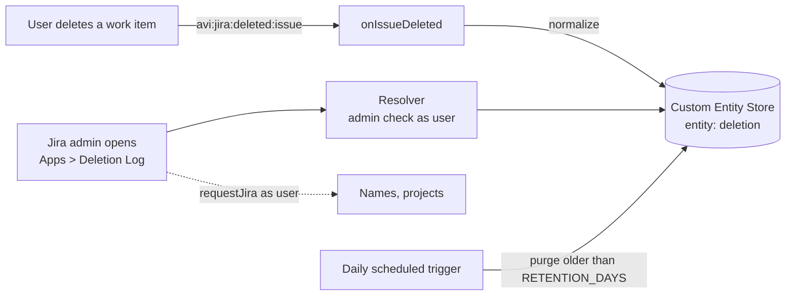

<div align="center">

# 🗑️ Deletion Log

**An audit trail for deleted Jira work items, built as a private Atlassian Forge app.**

Every deletion is recorded. Jira admins browse, filter and export the log from one page.


</div>

---

## 🎬 Demo

[](https://res.cloudinary.com/eyxelttg/video/upload/v1792520656/deletion-log-for-jira.mp4)

[▶ Watch the demo (MP4)](https://res.cloudinary.com/eyxelttg/video/upload/v1792520656/deletion-log-for-jira.mp4)

## ✨ Why

A Jira Automation rule used to react to every work item deletion. That worked, but each deletion burned an Automation run. Deletion Log does the same job with a Forge trigger and storage, so deletions no longer consume runs.

| | |
|---|---|
| 🔒 **Admin only** | Every resolver call checks that the current user is a Jira administrator. |
| ⚡ **Idempotent** | One record per work item (key = issue ID), so redelivered events never duplicate. |
| 🔎 **Filterable** | Date range, project, deleted by, exact work item key. |
| 📤 **CSV export** | Exports everything matching the filters, UTF-8 with BOM, safe against formula injection. |
| 🧹 **Self-cleaning** | A daily job purges records older than `RETENTION_DAYS`. |
| 🌗 **Light and dark** | Atlassian design tokens, no bundled fonts or remote assets. |

## 🧭 How it works



- The trigger never calls Jira. It stores what the event payload contains.
- No `asApp()` calls anywhere.
- No external egress and no remote CDNs. Everything is bundled.
- Access is enforced in the resolver on every call through `/rest/api/3/mypermissions?permissions=ADMINISTER`, run as the current user. The page is a `jira:adminPage`, so it only appears in Jira admin settings, but the resolver check is the real gate.
- Display names are never stored. The browser resolves account IDs as the current user.

## 🗄️ Stored data

One entity `deletion`, key = issue ID. Optional attributes are omitted when missing.

| Attribute | Source |
|---|---|
| `issueId`, `issueKey` | `issue.id`, `issue.key` |
| `projectId`, `projectKey`, `projectName` | `fields.project` |
| `summary`, `issueTypeName`, `statusName` | `fields.summary`, `fields.issuetype.name`, `fields.status.name` |
| `reporterId`, `assigneeId`, `creatorId` | account IDs from `fields` |
| `deletedById` | `atlassianId`, else `associatedUsers` |
| `parentKey` | `fields.parent.key` (sub-tasks) |
| `createdAt`, `updatedAt`, `deletedAt` | ISO 8601 UTC with milliseconds |
| `schemaVersion` | integer |

Priority and labels are not part of the event payload (confirmed in the payload spike), so they are not stored.

**Indexes:** `by-deleted-at`, `by-project` (partition `projectId`), `by-actor` (partition `deletedById`) and `by-issue-key` (partition `issueKey`), all ranged on `deletedAt`. Three of the seven index slots stay free.

> [!WARNING]
> Entities, attributes and deployed indexes cannot be deleted in Forge. Check the index status before relying on queries:
> ```bash
> forge storage entities indexes list -e development   # wait until all indexes are ACTIVE
> ```

## 🔑 Scopes

| Scope | Why |
|---|---|
| `read:jira-work` | Receive `avi:jira:deleted:issue`, call `GET /rest/api/3/mypermissions` and `GET /rest/api/3/project/search` |
| `read:jira-user` | `GET /rest/api/3/user/bulk` and `GET /rest/api/3/user/search` (names in the table, the user picker) |
| `storage:app` | Custom Entity Store |

## ⚙️ Configuration

`RETENTION_DAYS` is a Forge environment variable. Default **365**, allowed **30 to 1825**. Values outside the range are clamped. The purge runs daily.

```bash
forge variables set -e production RETENTION_DAYS 365
```

## 🛠️ Development

Requires Node 24 and the [Forge CLI](https://developer.atlassian.com/platform/forge/getting-started/).

```bash
npm install
npm --prefix static/main install
npm run build      # builds static/main into static/main/build
npm test
npm run lint
forge lint
```

<details>
<summary><b>Project layout</b></summary>

```text
manifest.yml
src/
  index.js              exports onIssueDeleted, handler, onRetentionTick
  events/issueDeleted.js
  resolvers/index.js
  services/             deletionStore, permissions, retention
  lib/                  constants, normalize (pure), filters (pure)
static/main/            Custom UI (React + Vite, base './')
test/                   Vitest
```

</details>

## 🚀 Private install

`manifest.yml` is not committed because it holds the registered app id. Create it from the example, then `forge register` writes your own app id into it:

```bash
cp manifest.yml.example manifest.yml
```

These commands touch a remote environment, so run them yourself.

```bash
forge register                                   # in the company-owned developer space
forge deploy -e development
forge install --site <site>.atlassian.net --product jira -e development
forge logs -e development

forge variables set -e production RETENTION_DAYS 365
forge deploy -e production
forge install --site <site>.atlassian.net --product jira -e production
```

When a later deploy adds scopes, upgrade the existing installation with `forge install --upgrade`.

Uninstall with `forge uninstall`. Stored data is removed according to the Forge data deletion policy.

## 🔁 Cutover from the Automation rule

- [ ] Install in production and run it in parallel with the existing rule for **two weeks**.
- [ ] Compare: every deletion the rule caught must also be in the log.
- [ ] Disable the rule (manual step, not part of this app).

## ⚠️ Known limitations

- Only deletions made **after** the app was installed are recorded.
- Cascading deletions do not emit events. When a project is purged from the trash, its work items are not recorded one by one.
- The event payload has a limited set of fields. Description, comments, custom fields, attachments, worklogs and links are not stored, so nothing can be restored in this version.
- The deleting user can be missing in rare cases. The record then shows "Unknown".
- Queries are eventually consistent: a fresh deletion can appear with a short delay.
- Event delivery is asynchronous and can be delayed. The Jira audit log remains the system of record; this app is a convenience view.
- Admins see all records regardless of project permissions and issue security levels. This is intentional.
- Summaries of deleted work items stay in the log until the retention period ends or an admin removes the record.
- Filtering by project and user together runs after the page is read, so pages can be short or empty while "Load more" is still available.
- A failed storage write in the trigger is retried up to 4 times with backoff (30 s, 60 s, 120 s, 240 s). If the last retry also fails, the deletion is not recorded; the error is logged without record values.

## 🔮 Roadmap

Nothing below is built.

<details>
<summary><b>Phase 2: restore (Trash Can style)</b></summary>

Build it only if a real case of lost content happens, and only after comparing the cost with an existing app (Trash Can, IssueRescue).

- Snapshots must be taken before deletion. Subscribe to created, updated and commented events, scoped to selected projects, with `ignoreSelf: true`.
- Triggers have no user, so fetching the full work item needs `asApp()`. This is an accepted exception for Phase 2 only.
- Store the latest snapshot per work item in a new entity `issue-snapshot`, within the 240 KiB object limit.
- Restore runs as the current admin (`asUser()`). Add `restoredKey`, `restoredAt` and `restoredById` to `deletion` to block double restores.
- Jira Service Management caveats: the restored item gets a new key and ID, SLA timers start over, customers can receive notifications and "Work item created" rules will fire. Add a label such as `restored-by-deletion-log` and matching rule conditions first.
- Not restorable: original key and ID, history, worklog authorship, attachments, approvals.
- Design the new entity and indexes in development first, because production indexes cannot be removed.

</details>

**Later ideas**

- Record project trash and purge events (`avi:jira:softdeleted:project`, `avi:jira:deleted:project`).
- Alert when one user deletes more than N work items in a short window.

## License

This project is licensed under the [MIT License](LICENSE).
